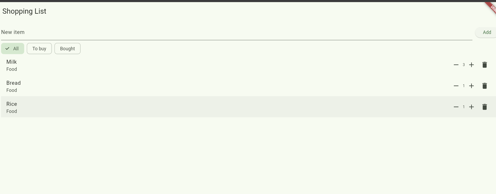
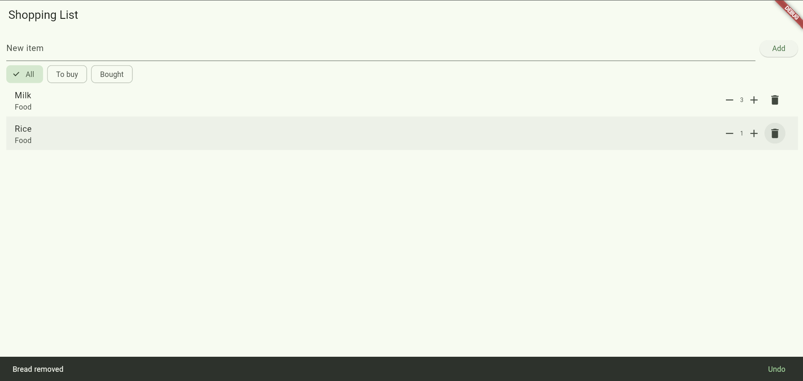
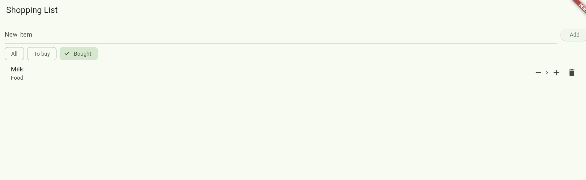
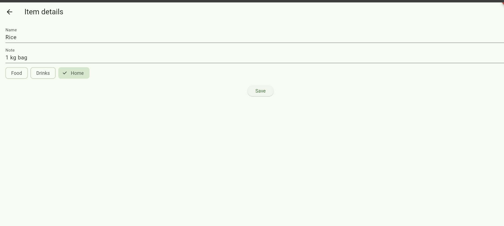

# shopping_list

A new Flutter project.# Shopping List+

A Flutter shopping list app, upgraded in six steps.

## Features
1. **Empty list message:** the page shows "Your list is empty" when there are no items.
2. **Quantity:** every item has - and + buttons, and the quantity never goes below 1.
3. **No duplicates:** adding an item that already exists (any capitals or spaces) raises its quantity and shows a message.
4. **Undo:** deleting an item shows a message with an Undo button, and Undo puts the item back in the same place.
5. **Filters:** All / To buy / Bought chips. Bought items sit at the bottom of All. "Nothing here" shows when a filter is empty.
6. **Item details:** a long-press opens a second screen to edit the name, note and category (Food, Drinks, Home). An empty name is refused.

## Screenshots

### Quantities

### Undo message

### Bought filter

### Item details

## Think

**1. In part 5, why does deleting by `index` remove the wrong item when a filter is on? How did you fix it?**

With a filter on, the screen shows `shown`, a filtered copy of the list. The `index` is a position in `shown`, not in `items`, so row 0 on the screen is not item 0 of `items`. Removing by index deletes a different item, with no error. I fixed it by deleting the item itself with `items.remove(item)`.

**2. Why did you have to remove `final` from `name`? Why is `final` still a good choice for most fields?**

A `final` field can be set only once. Renaming an item on the details screen changes `name`, so it could not be `final` any more. `final` is still a good choice for most fields because it stops accidental changes, so bugs are easier to find and the data is more predictable.

**3. Why did you need a hot restart after adding `quantity` to `Item`, when a save was enough for everything else?**

Hot reload only re-runs code like `build`, and it keeps the objects that already exist. The Milk, Bread and Rice objects were created before `quantity` existed, so they did not have the new field. A hot restart starts the app again and creates the items with the new `Item` class.

**4. The details screen changed the item, but the list only showed it after `setState` in `.then`. Why? What does this tell you about how Flutter decides when to redraw?**

Changing the data inside an object does not make Flutter redraw. Flutter redraws a screen only when `setState` is called on it. The details screen changed the item, but the list screen was not told. The `.then(...)` runs when the user comes back, and its `setState` makes the list rebuild and show the new values.